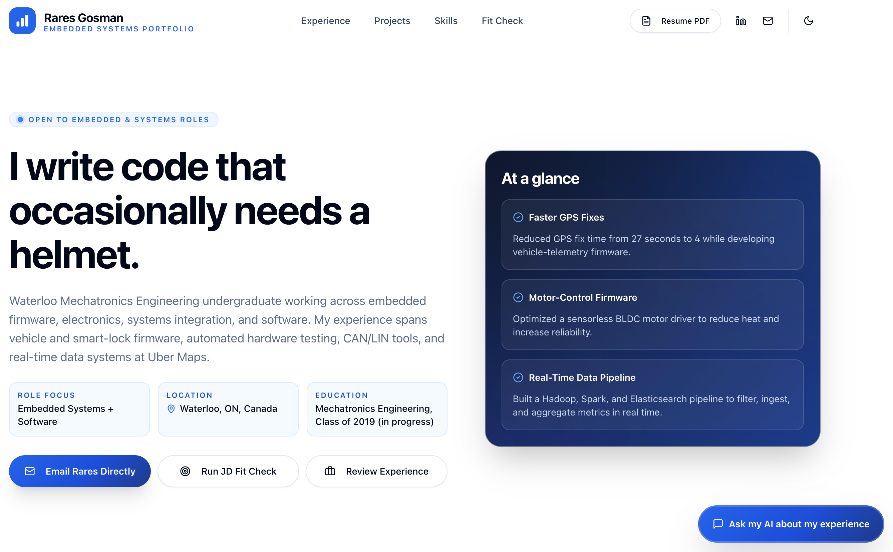
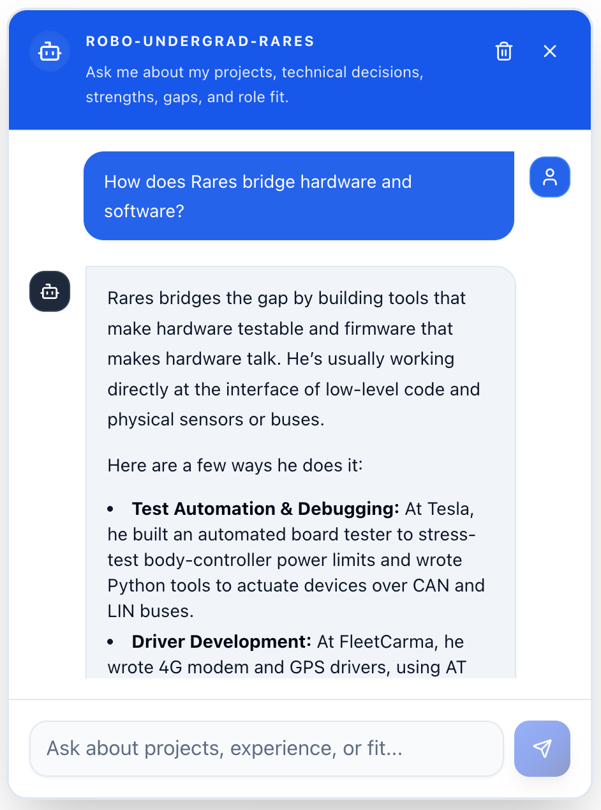
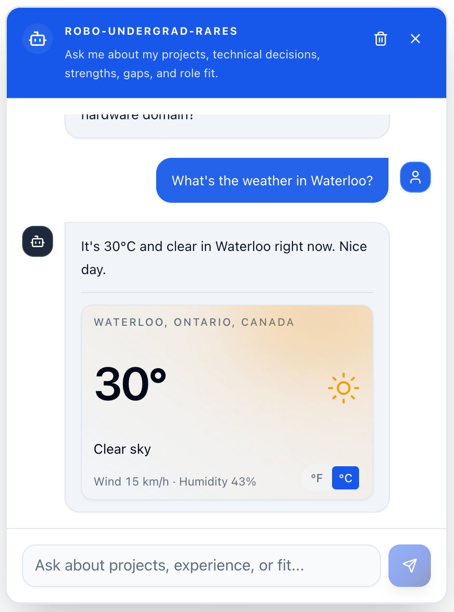
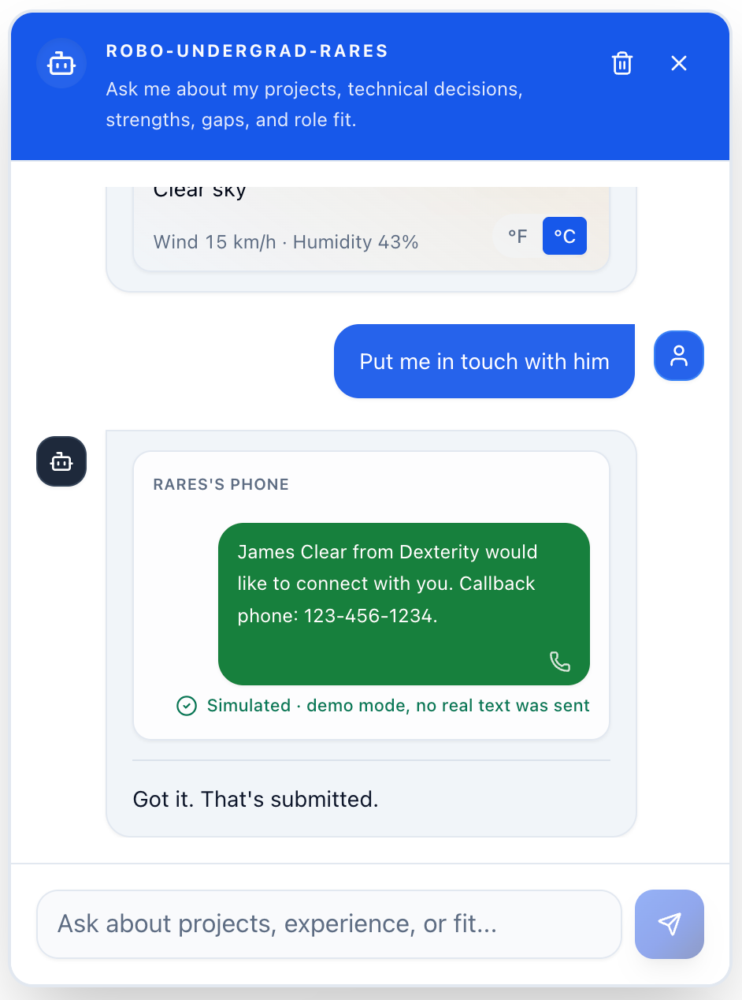
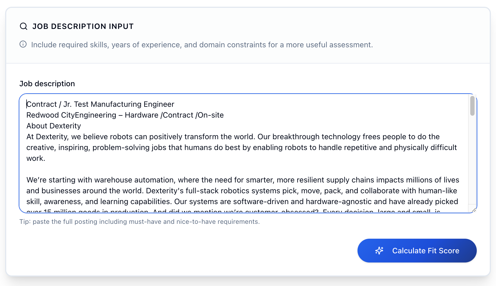
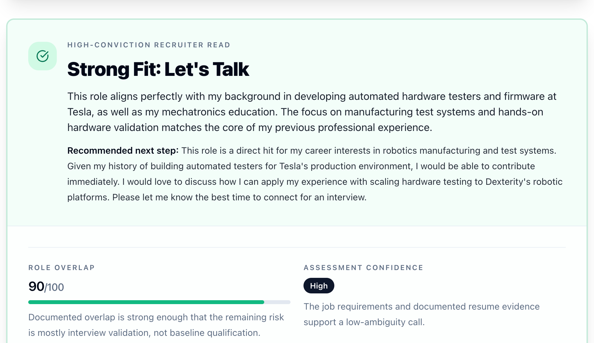

# AI Portfolio Template

An AI-powered personal portfolio you deploy on Cloudflare. It renders a single-page site with an AI
"recruiter chat" that answers questions about your experience, plus a job-description fit-check, all
driven from two content files so you never touch the app code to personalize it.

The template ships with a fictional "Jordan Ellis" persona so it runs green out of the box. Replace
that content with your own (an agent can do it for you) and deploy.

## See it in action

<table>
  <tr>
    <td colspan="6" align="center">
      <a href="docs/images/portfolio/landing.png"></a><br>
      <sub><b>Personalized landing page:</b> experience, proof points, and calls to action at a glance.</sub>
    </td>
  </tr>
  <tr>
    <td colspan="2" align="center">
      <a href="docs/images/portfolio/chat-1.png"></a><br>
      <sub><b>Grounded answers:</b> ask about experience, projects, or role fit.</sub>
    </td>
    <td colspan="2" align="center">
      <a href="docs/images/portfolio/chat-2-tool.png"></a><br>
      <sub><b>Live tools:</b> structured tool results render directly in the conversation.</sub>
    </td>
    <td colspan="2" align="center">
      <a href="docs/images/portfolio/chat-3-tool.png"></a><br>
      <sub><b>Contact handoff:</b> turn recruiter interest into a direct follow-up.</sub>
    </td>
  </tr>
  <tr>
    <td colspan="3" align="center">
      <a href="docs/images/portfolio/jd-input.png"></a><br>
      <sub><b>Paste a job description:</b> provide the full posting for a useful comparison.</sub>
    </td>
    <td colspan="3" align="center">
      <a href="docs/images/portfolio/jd-output.png"></a><br>
      <sub><b>Get an honest assessment:</b> see evidence, gaps, confidence, and a recommended next step.</sub>
    </td>
  </tr>
</table>

## Set it up with your agent

The fastest path is to let an AI coding agent (Claude Code or OpenAI Codex) personalize and deploy
it for you. Paste this to your agent:

```
Read SETUP.md and guide me through setting up this portfolio.
```

[`SETUP.md`](SETUP.md) is the interactive builder guide: it interviews you, ingests your resume,
writes the content, validates, previews locally, and walks you through the Cloudflare deploy.

Bring your own resume as a PDF path, text, or Markdown. If your agent cannot extract a PDF cleanly,
use [LiteDoc](https://litedoc.xyz/) ([source](https://github.com/0xovo/LiteDoc)) to convert it locally
in your browser, review the result, and paste the Markdown into the agent chat. To show the original
PDF on the portfolio, the setup flow copies it into `public/` only after you approve publishing it;
the template does not generate a new PDF from Markdown.

## Features

- **AI recruiter chat** with streaming responses and same-tab refresh continuity (chat history is
  held client-side in `sessionStorage`).
- **JD fit-check** (`POST /api/analyze-fit`): paste a job description and get an evidence-backed
  fit assessment with explicit gaps. "Not a fit" is a valid, honest outcome.
- **Weather tool** the assistant can call inline.
- **Optional SMS contact handoff** (Twilio): the assistant can text you a visitor's contact details.
  Self-disables to a safe simulation when Twilio is not configured.
- **Optional Turnstile** bot protection using a verify-once signed lease.
- Server-side tenant isolation, per-tenant/per-IP rate limits, and request-size caps.

## Content model (the content seam)

You personalize the site by editing two files, not the app:

- `content/portfolio.yaml` - structured facts (identity, experience, projects, skills, education,
  SEO, homepage copy, starter prompts).
- `content/prose/summary.md` - the long-form professional summary (one plain paragraph).

Running `bun run content:build` validates the YAML with Zod and regenerates the **committed**
`shared/content.generated.ts`, which the app, worker, and tests read via `shared/resume-canonical.ts`.
`bun run content:check` is a drift guard (the first step of `bun run check`) that fails if the
generated file is stale. Never hand-edit `shared/content.generated.ts`.

The full content schema (required vs optional keys, the `education` list, the
`proofPoints.sourceId` rule) is documented in [`SETUP.md`](SETUP.md#stage-4---write-the-content).

## Local development

Requires [Bun](https://bun.sh). Then:

```bash
bun install
cp .dev.vars.example .dev.vars   # fill in your local values (see the env table below)
bun run dev
```

Open `http://localhost:3000` (override with `PORT`). The `predev` hook regenerates
`shared/content.generated.ts` from `content/*` before the server starts.

## Command reference

| Command                      | What it does                                                        |
| ---------------------------- | ------------------------------------------------------------------- |
| `bun run dev`                | Vite dev server on `0.0.0.0:${PORT:-3000}`.                         |
| `bun run build`              | Production build.                                                   |
| `bun run preview`            | Build, then serve the production bundle on `${PORT:-4173}`.         |
| `bun run content:build`      | Validate `content/*` and regenerate `shared/content.generated.ts`.  |
| `bun run content:check`      | Fail if the generated content file is stale (drift guard).          |
| `bun run check`              | content:check + prettier + eslint + typecheck + knip.               |
| `bun run check:fix`          | Autofix pass (format + lint:fix + typecheck + knip).                |
| `bun run test`               | Run the test suite (regenerates content first).                     |
| `bun run format`             | Prettier write pass.                                                |
| `bun run cf-typegen`         | Regenerate Worker types (`wrangler types`).                         |
| `bun run predeploy:validate` | Validate `wrangler.jsonc` is deploy-ready (rejects the sentinel).   |
| `bun run deploy:dry-run`     | Validate + build + `wrangler deploy --dry-run`.                     |
| `bun run deploy:init`        | One-time fresh-account first publish (creates the Worker).          |
| `bun run deploy`             | Validate + build + `wrangler deploy` + post-deploy AI health smoke. |
| `bun run smoke:ai`           | Probe `GET /api/health/ai` on a deployed URL.                       |
| `bun run smoke:ai:online`    | Opt-in live health, chat/tool, and structured-fit verification.     |

## Environment variables

Copy `.dev.vars.example` to `.dev.vars` for local development. `.dev.vars` is gitignored; never
commit secrets. See [`DEPLOYMENT.md`](DEPLOYMENT.md) for the full "what lives where" table.

| Variable                                                                                 | Required?                        | Where                                        |
| ---------------------------------------------------------------------------------------- | -------------------------------- | -------------------------------------------- |
| `AI_PROVIDER`                                                                            | Required                         | `wrangler.jsonc` var; `.dev.vars` locally.   |
| `CF_AI_BASE_URL`                                                                         | Required                         | `wrangler.jsonc` var; `.dev.vars` locally.   |
| `CF_AI_GATEWAY_TOKEN`                                                                    | Google provider only             | Secret / `.dev.vars` (AI Gateway token).     |
| `SECURITY_HMAC_SECRET`                                                                   | Required                         | Secret / `.dev.vars` (signs tenant cookies). |
| `REQUIRE_TURNSTILE`                                                                      | Required var (`"false"` default) | `wrangler.jsonc` var.                        |
| `VITE_TURNSTILE_SITE_KEY`                                                                | If Turnstile enabled             | Build-time env (`.env.local` / shell).       |
| `TURNSTILE_SECRET_KEY`                                                                   | If Turnstile enabled             | Secret / `.dev.vars`.                        |
| `CONTACT_SMS_TO_NUMBER`, `TWILIO_ACCOUNT_SID`, `TWILIO_AUTH_TOKEN`, `TWILIO_FROM_NUMBER` | Optional (SMS handoff)           | Secrets / `.dev.vars`.                       |
| `AI_HEALTH_TOKEN`                                                                        | Optional                         | Secret; gates `GET /api/health/ai` if set.   |
| `CLOUDFLARE_API_TOKEN`, `CLOUDFLARE_ACCOUNT_ID`                                          | Optional (deploy auth)           | Shell / CI (not runtime bindings).           |

`AI_PROVIDER` selects `workers-ai` (Gemma 4 with GLM-4.7-Flash fallback through the `AI` binding) or
`google-gateway` (the native Gemini path). Provider-specific model chains live in
`shared/models.ts`; routes do not change when switching. `CF_AI_BASE_URL` is the Gateway locator
both paths use. Keep its `/compat` suffix. `CF_AI_GATEWAY_TOKEN` is required only for Google.

For Google BYOK, create a [Google AI Studio key](https://aistudio.google.com/api-keys), then store it
in Cloudflare under **AI > AI Gateway > select the gateway > Provider Keys > Add API Key > Google AI
Studio**. Do not put the Google key in `CF_AI_GATEWAY_TOKEN`; that secret holds the separate Cloudflare
Authenticated Gateway token. See [DEPLOYMENT.md](DEPLOYMENT.md#ai-gateway-setup).

## API surface

- `GET /api/health` - basic liveness.
- `GET /api/health/ai` - AI gateway health probe (optionally bearer-gated by `AI_HEALTH_TOKEN`).
- `GET /api/chat/bootstrap` - challenge/turnstile state for the client.
- `POST /api/chat/verify-turnstile` - exchange a solved Turnstile token for a signed lease.
- `POST /api/chat` - streaming chat turn.
- `POST /api/contact-handoff` - idempotent SMS contact handoff.
- `POST /api/analyze-fit` - one-shot JD fit assessment.
- `POST /api/client-errors` - metered client error sink.

## Deploy

By default the Worker publishes to `https://<name>.<subdomain>.workers.dev`, where `<name>` is the
Worker `name` in `wrangler.jsonc`. A custom domain is optional: add a `routes` block with
`custom_domain: true` for a zone on your Cloudflare account, and Cloudflare provisions the DNS record
and TLS certificate.

For a guided, agent-run deploy, follow [`SETUP.md`](SETUP.md#stage-7---deploy-to-cloudflare). For
the detailed manual procedure (AI Gateway setup, secrets, Turnstile, custom domains,
troubleshooting), see [`DEPLOYMENT.md`](DEPLOYMENT.md).

## Repository layout

- `content/` - the content seam (`portfolio.yaml` + `prose/summary.md`).
- `src/` - React 19 single-page frontend.
- `worker/` - Cloudflare Worker: Hono routes, security, chat/AI runtime, Durable Object.
- `shared/` - shared prompts, models, contracts, and the generated resume data.
- `scripts/` - content codegen, predeploy validation, smoke and weather scripts.
- `docs/` - architecture and reference documentation (see [`docs/INDEX.md`](docs/INDEX.md)).
- `wrangler.jsonc` - Worker config, vars, and Durable Object bindings.

For the repo map, sources of truth, and invariants agents must respect, see [`AGENTS.md`](AGENTS.md).

## License

[MIT](LICENSE) © Rareș Gosman. Fork it, personalize it, ship it.
